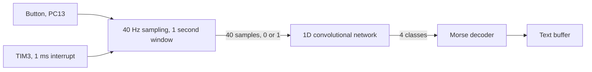

# TinyML Morse decoder on a Cortex-M0

STM32F091 · X-CUBE-AI · 1D CNN in 3.4 KB of weights

   

**English** | [Türkçe](README.tr.md) · An open-source project by [TECH-OHM](https://tech-ohm.com)

An application that classifies how a single button is pressed with a small neural network and turns the result into text through Morse code. The network runs on a 48 MHz Cortex-M0 with 3.4 KB of weights and 1 KB of RAM.

You do not need a neural network to decode Morse. Measuring press duration is enough. The point here was to take a model trained in TensorFlow, fit it into one of the smallest STM32s with X-CUBE-AI, and run it end to end.

## Block diagram

## How it works

TIM3 raises an interrupt every millisecond. Every 25 ms the button state is read and written to an array. After 40 samples, which is one second, the window goes to the network. The network puts the window into one of four classes:

| Class | Press | Action |
|---|---|---|
| 0 | short press | a dot is added |
| 2 | long press | a dash is added |
| 3 | no press | the letter ends, collected dots and dashes are looked up |
| 1 | double click | the word ends, the letter is written and a space is added |

To write `A`: press short within one second, press long in the next second, wait in the one after.

The application stops after 30 windows (30 seconds). The decoded text is in the `message` array and can be read in the Live Expressions or Memory view while debugging.

## Model

| | |
|---|---|
| Input | 40 samples, one channel |
| Layers | Conv1D (4 filters), MaxPool, Conv1D (8 filters), MaxPool, two dense layers (8 and 4 units) |
| Output | 4 classes |
| Parameters | 876 |
| Weights (Flash) | 3.42 KB |
| Activations (RAM) | 1.02 KB |
| Complexity | 5404 MACC |

The model was trained in Keras, exported as `.tflite`, and converted to C with X-CUBE-AI 10.2 inside STM32CubeMX. No compression, 32-bit float weights.

The complete binary takes about 32 KB of Flash and 9 KB of RAM.

## Folders

| Folder | Content |
|---|---|
| `model/` | the trained model, `model_40hz_1sec.tflite` |
| `X-CUBE-AI/App/` | C files generated from the model and the conversion report |
| `Middlewares/ST/AI/` | ST's neural network runtime library |
| `Core/Src/main.c` | sampling, inference and Morse decoding |

The training script and dataset are not in this repository.

## Pins

| Pin | Function |
|---|---|
| PC13 | button, low when pressed |
| PA5 | LED |

Both are on the NUCLEO-F091RC board, so no external wiring is needed.

## Build

In STM32CubeIDE use `File > Import > Existing Projects into Workspace` and select this folder. To change the model, open the `.ioc` file, point the X-CUBE-AI tab at the new `.tflite` file and regenerate the code.

## License

The application code in `Core/Src/main.c` is MIT licensed. The files generated by X-CUBE-AI and the runtime library come under ST's license, see `LICENSE_X-CUBE-AI.txt`. The HAL and CMSIS files under `Drivers` keep their own licenses too.

## Author

M. Eyüb Can, embedded systems engineer and founder of [TECH-OHM](https://tech-ohm.com)

## About TECH-OHM

[TECH-OHM](https://tech-ohm.com) designs electronic boards and embedded software, from the first schematic to series production. We also run a 12-month embedded systems training program and consult for engineering teams.

Web: [tech-ohm.com](https://tech-ohm.com) · Email: info@tech-ohm.com
