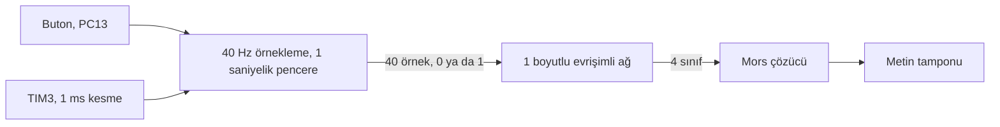

# STM32F091 üzerinde sinir ağıyla mors çözücü (TinyML)

Tek bir butona basış biçimini küçük bir sinir ağıyla sınıflandırıp mors alfabesinden metne çeviren uygulama. Ağ, 48 MHz'lik bir Cortex-M0 üzerinde, 3.4 KB ağırlık ve 1 KB RAM ile çalışıyor.

Mors çözmek için sinir ağı şart değil, basış süresini ölçmek de yeter. Burada amaç, TensorFlow'da eğitilmiş bir modeli X-CUBE-AI ile en küçük STM32'lerden birine sığdırıp uçtan uca çalıştırmaktı.

## Blok diyagram

## Nasıl çalışıyor

TIM3 milisaniyede bir kesme üretiyor. Her 25 milisaniyede butonun durumu okunup bir diziye yazılıyor. 40 örnek dolunca, yani bir saniyede, pencere sinir ağına veriliyor. Ağ pencereyi dört sınıftan birine atıyor:

| Sınıf | Basış | Yapılan iş |
|---|---|---|
| 0 | kısa basış | nokta eklenir |
| 2 | uzun basış | çizgi eklenir |
| 3 | hiç basılmadı | harf biter, biriken nokta ve çizgiler tabloda aranır |
| 1 | çift tık | kelime biter, harf yazılır ve boşluk eklenir |

Örneğin `A` yazmak için: bir saniye içinde kısa bas, sonraki saniyede uzun bas, sonraki saniyede bekle.

Uygulama 30 pencere (30 saniye) topladıktan sonra duruyor. Çözülen metin `message` dizisinde, debug sırasında Live Expressions ya da Memory penceresinden okunuyor.

## Model

| | |
|---|---|
| Giriş | 40 örnek, tek kanal |
| Katmanlar | Conv1D (4 filtre), MaxPool, Conv1D (8 filtre), MaxPool, iki tam bağlı katman (8 ve 4 nöron) |
| Çıkış | 4 sınıf |
| Parametre | 876 |
| Ağırlıklar (Flash) | 3.42 KB |
| Aktivasyonlar (RAM) | 1.02 KB |
| İşlem yükü | 5404 MACC |

Model Keras'ta eğitilip `.tflite` olarak dışa aktarıldı, ardından STM32CubeMX içindeki X-CUBE-AI 10.2 ile C koduna çevrildi. Sıkıştırma kullanılmadı, ağırlıklar 32 bit kayan nokta.

Derlenmiş programın tamamı yaklaşık 32 KB Flash ve 9 KB RAM tutuyor.

## Klasörler

| Klasör | İçerik |
|---|---|
| `model/` | eğitilmiş model, `model_40hz_1sec.tflite` |
| `X-CUBE-AI/App/` | modelden üretilen C dosyaları ve dönüşüm raporu |
| `Middlewares/ST/AI/` | ST'nin sinir ağı çalışma zamanı kütüphanesi |
| `Core/Src/main.c` | örnekleme, ağın çağrılması ve mors çözme |

Eğitim betiği ve veri seti bu depoda yok.

## Pinler

| Pin | Görev |
|---|---|
| PC13 | buton, basılıyken 0 |
| PA5 | LED |

İkisi de NUCLEO-F091RC kartının üzerinde, dışarıdan bağlantı gerekmiyor.

## Derleme

STM32CubeIDE'de `File > Import > Existing Projects into Workspace` ile klasörü seç. Modeli değiştirmek istersen `.ioc` dosyasını açıp X-CUBE-AI sekmesinden yeni `.tflite` dosyasını göster ve kodu yeniden üret.

## Lisans

`Core/Src/main.c` içindeki uygulama kodu MIT lisanslı. X-CUBE-AI ile üretilen dosyalar ve çalışma zamanı kütüphanesi ST'nin lisansıyla gelir, metni `LICENSE_X-CUBE-AI.txt` içinde. `Drivers` klasöründeki HAL ve CMSIS dosyaları da kendi lisanslarını taşır.

## Yazar

Gömülü Sistem Mühendisi M. Eyüb Can, [TECH-OHM](https://tech-ohm.com)
